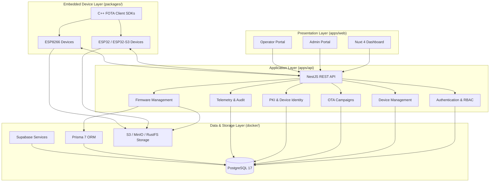
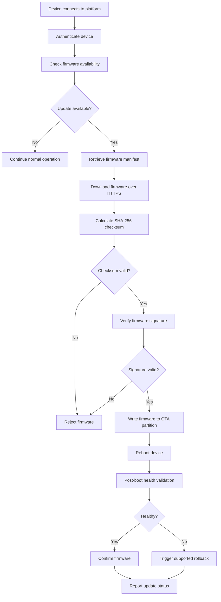

<p align="center">
  <a href="https://fota.nodewave.net">
    
  </a>
</p>

<h1 align="center">Secure Firmware Over-The-Air (FOTA) Update Management Platform</h1>

<p align="center">
  <strong>Secure Firmware. Reliable Updates. Complete Fleet Control.</strong>
</p>

<p align="center">
  <a href="https://fota.nodewave.net">Live Platform</a> •
  <a href="#system-architecture">System Architecture</a> •
  <a href="#security-architecture">Security Architecture</a> •
  <a href="#getting-started">Getting Started</a> •
  <a href="https://github.com/Nodewave-EA/nodefota">GitHub</a>
</p>

<p align="center">
  
  
  
  
  
  
</p>

---

**NODEFOTA** is a Firmware Over-The-Air (FOTA) management platform for securely distributing, deploying, monitoring, and
managing firmware updates across IoT devices.

The platform combines a Nuxt 4 management dashboard, a modular NestJS REST API, S3-compatible firmware storage and
delivery, containerized infrastructure services, and embedded C++ client libraries for ESP32 and ESP8266 devices.

**Developed as an IoT engineering initiative associated with [NodeWave](https://nodewave.net).**

---

## Table of Contents

- [Overview](#overview)
- [Why This Project?](#why-this-project)
- [Key Features](#key-features)
- [System Architecture](#system-architecture)
- [Firmware Update Workflow](#firmware-update-workflow)
- [Security Architecture](#security-architecture)
- [Supported Hardware](#supported-hardware)
- [Technology Stack](#technology-stack)
- [Project Structure](#project-structure)
- [Getting Started](#getting-started)
- [Configuration](#configuration)
- [API Documentation](#api-documentation)
- [Embedded Client Libraries](#embedded-client-libraries)
- [Deployment Strategies](#deployment-strategies)
- [Limitations and Scope](#limitations-and-scope)
- [Roadmap](#roadmap)
- [Security Considerations](#security-considerations)
- [Contributing](#contributing)
- [License](#license)
- [Acknowledgements](#acknowledgements)

---

## Overview

Managing firmware across deployed IoT devices is a significant operational and security challenge. Manual firmware
installation, fragmented update mechanisms, insecure binary distribution, and limited device visibility make maintaining
connected devices increasingly difficult.

The **NODEFOTA Platform** addresses these challenges by providing a centralized system for managing the firmware
lifecycle.

It enables authorized operators to:

- Register and manage IoT devices.
- Upload and organize firmware releases.
- Generate firmware manifests and cryptographic signatures.
- Distribute firmware through secure download mechanisms.
- Create and manage OTA deployment campaigns.
- Monitor device update progress and telemetry.
- Configure deployment and rollback policies.
- Manage device authentication and certificates.
- Review security-sensitive operations through audit logs.

The platform is designed primarily for **ESP32** and **ESP8266** microcontroller-based IoT devices and runs on
containerized Docker Compose infrastructure.

### Project Objectives

1. Build a modular REST API for device, firmware, and update lifecycle management.
2. Provide cryptographic integrity and authenticity verification for firmware artefacts.
3. Support controlled firmware deployment through configurable OTA campaigns.
4. Develop embedded client libraries for resource-constrained IoT devices.
5. Provide centralized device monitoring, telemetry, and auditability.
6. Implement device identity and authentication using JWTs, API keys, and X.509 certificates.

---

## Why This Project?

Traditional firmware update workflows often introduce several operational and security weaknesses:

| Challenge                          | Platform Approach                                     |
| :--------------------------------- | :---------------------------------------------------- |
| Unauthorized firmware modification | SHA-256 integrity verification and digital signatures |
| Insecure firmware distribution     | HTTPS and signed firmware download URLs               |
| Manual device updates              | Centralized OTA campaign management                   |
| Uncontrolled fleet-wide releases   | Immediate, gradual, canary, and scheduled deployments |
| Limited device visibility          | Device status, update progress, and telemetry         |
| Weak device authentication         | Device JWTs, API keys, and X.509/mTLS                 |
| Failed firmware deployments        | Rollback policies and device-side recovery mechanisms |
| Missing operational accountability | Audit logging of security-sensitive actions           |

The goal is to make firmware updates a controlled, verifiable, and observable part of the IoT device lifecycle.

---

## Key Features

### 1. Device Management

Centralized management of registered IoT devices:

- Device registration and identification.
- Hardware model and firmware version tracking.
- Device authentication and credential management.
- Device status monitoring and last-seen heartbeat tracking.
- Device-specific OTA configuration.
- Device X.509 certificate provisioning.

### 2. Firmware Lifecycle Management

Manage firmware artefacts throughout their lifecycle:

- Firmware metadata and version management.
- Firmware binary and filesystem image uploads.
- Hardware platform identification (`ESP32`, `ESP32-S3`, `ESP8266`).
- SHA-256 checksum generation and verification.
- Cryptographically signed firmware manifests.
- Firmware release lifecycle management (`Staging`, `Canary`, `Stable`).
- Secure firmware downloads through pre-signed S3 URLs.

### 3. OTA Campaign Management

Deploy firmware updates to selected device groups using configurable rollout strategies:

| Strategy    | Description                                                       |
| :---------- | :---------------------------------------------------------------- |
| `IMMEDIATE` | Make the update available immediately to eligible target devices. |
| `GRADUAL`   | Roll out updates progressively using percentage-based deployment. |
| `CANARY`    | Start with a limited device group before broader deployment.      |
| `SCHEDULED` | Configure deployment for a specified schedule.                    |

Campaign management includes target device selection, firmware version assignment, campaign scheduling and activation,
per-device update tracking, deployment progress reporting, failure-rate monitoring, and configurable rollback policies.

### 4. Secure Device Authentication

The platform provides multiple device authentication mechanisms:

- Device-specific API keys (stored as bcrypt hashes rather than plaintext credentials).
- Device JWT authentication.
- X.509 certificate provisioning via PKCS#10 Certificate Signing Requests (CSR).
- Mutual TLS (mTLS) authentication.

### 5. Fleet Monitoring and Telemetry

Collect operational information from connected devices across supported telemetry event categories:

- `HEARTBEAT`
- `STATUS_UPDATE`
- `ERROR`
- `PROGRESS`
- `CUSTOM`

Operators can monitor device activity, update states, and reported telemetry through the management dashboard.

### 6. Rollback and Recovery

The platform combines campaign-level rollback policies with supported device-side recovery mechanisms:

- Maximum permitted failure rate and minimum update count before evaluating thresholds.
- Automatic campaign cancellation and rollback event logging when thresholds are exceeded.
- Native dual-partition (`ota_0` / `ota_1`) OTA rollback and a post-boot health watchdog on supported ESP32
  configurations to validate startup before confirming new firmware.

### 7. Audit Logging

Security-sensitive operations are recorded for operational accountability, including authentication events, device
registration and updates, firmware uploads, campaign creation/activation, credential/configuration changes, and rollback
events.

### 8. Platform Administration

The management dashboard provides separate administrative and operator capabilities:

- **ADMIN:** User management, platform-wide configuration, audit log review, authentication log review, PKI and
  certificate management, and administrative settings.
- **OPERATOR:** Device management, firmware management, OTA campaign management, telemetry monitoring, API key
  management, and filesystem image management.

---

## System Architecture

The platform consists of four primary layers orchestrated via Docker Compose and Caddy reverse proxy:



### Component Responsibilities

| Component                 | Path                             | Responsibility                                                            |
| :------------------------ | :------------------------------- | :------------------------------------------------------------------------ |
| **Nuxt 4 Web**            | `apps/web`                       | Web interface, operator dashboard, and admin portal                       |
| **NestJS API**            | `apps/api`                       | REST API, business logic, authentication, PKI, and device communication   |
| **Prisma 7**              | `apps/api/prisma`                | Database access, schema management, and migrations                        |
| **PostgreSQL & Supabase** | `docker/supabase`                | Persistent application data, auth, and supporting services                |
| **Caddy & Mailpit**       | `docker/caddy`, `docker/mailpit` | Reverse proxy TLS termination and local email testing                     |
| **MQTT Broker**           | `docker/mqtt`                    | Broker infrastructure and TLS certificates                                |
| **FOTA Client SDK**       | `packages/fota-client-esp32`     | Embedded OTA, device authentication, verification, and post-boot recovery |

---

## Firmware Update Workflow

The device-side update pipeline follows this sequence:



### Update Lifecycle

1. **Authentication:** The device authenticates with the platform using JWT, API key, or X.509 mTLS.
2. **Update discovery:** The device checks whether a firmware update is available for its hardware model and current
   version.
3. **Manifest retrieval:** The device obtains the firmware metadata and cryptographic verification information.
4. **Download:** The firmware binary is downloaded over HTTPS using a pre-signed URL.
5. **Integrity verification:** The device calculates and compares the SHA-256 checksum.
6. **Authenticity verification:** The device verifies the firmware signature using its configured public key.
7. **Installation:** The verified firmware is written to the inactive OTA partition.
8. **Reboot:** The device restarts into the updated firmware slot.
9. **Health validation:** Supported ESP32 configurations perform post-boot health validation via watchdog checks.
10. **Status reporting:** The device reports its update result (`SUCCEEDED` or `ROLLED_BACK`) to the platform.

---

## Security Architecture

Security is incorporated across device identity, firmware storage, distribution, verification, and deployment:

- **Firmware Integrity & Authenticity:** SHA-256 checksum verification, **ECDSA P-256**, **Ed25519**, and **RSA-SHA256**
  digital signatures, signed firmware manifests, and mandatory pre-flash verification.
- **Device Identity:** Device-specific API keys (bcrypt-hashed), device JWT authentication, X.509 certificates, PKCS#10
  Certificate Signing Requests (CSR) using on-device generated ECDSA P-256 key pairs (private keys never leave device
  flash), and Mutual TLS (mTLS).
- **Transport & Storage Security:** HTTPS device communication via Caddy, time-limited signed firmware upload and
  download URLs, S3-compatible object storage, role-based access control (`ADMIN` / `OPERATOR`), API rate limiting, and
  immutable audit logging.

---

## Supported Hardware

| Platform     | Embedded Framework   | Client Support                                            |
| :----------- | :------------------- | :-------------------------------------------------------- |
| **ESP32**    | Arduino / PlatformIO | Full ESP32 FOTA client (`packages/fota-client-esp32`)     |
| **ESP32-S3** | Arduino / PlatformIO | ESP32 FOTA client, subject to board and SDK compatibility |
| **ESP8266**  | Arduino / PlatformIO | ESP8266 FOTA client with a constrained feature subset     |

### Tested Development Boards

- `ESP32-WROOM-32`
- `ESP32-S3`
- `ESP8266 D1 Mini`

> **Hardware Constraints:** ESP8266 devices have significantly more constrained RAM and flash resources; OTA partition
> layout and binary size must be sized accordingly. Ed25519 verification depends on the bundled mbedTLS implementation
> (ESP-IDF 5.0+ where applicable).

---

## Technology Stack

- **Frontend (`apps/web`):** Nuxt 4, Vue 3, TypeScript, Nuxt UI v4, Tailwind CSS v4, Nuxt Content
- **Backend (`apps/api`):** NestJS 11, TypeScript, Prisma 7 ORM, PostgreSQL 17, Swagger / OpenAPI
- **Infrastructure (`docker/`):** Supabase, MinIO / RustFS S3 storage, Caddy reverse proxy, Mailpit, Mosquitto MQTT,
  Docker Compose
- **Package Manager & Runtime:** **Bun 1.x**
- **Embedded (`packages/fota-client-esp32`):** C++17, Arduino framework, PlatformIO (`platformio.ini`), Python build
  helpers

---

## Project Structure

```text
nodefota/
├── apps/
│   ├── api/                        # NestJS 11 REST API & Prisma 7 ORM
│   │   ├── prisma/                 # Database schema, migrations, and seeders
│   │   ├── src/                    # Modular NestJS domains (auth, devices, firmware, ota, pki, telemetry)
│   │   ├── Dockerfile.api.dev      # Development container definition
│   │   ├── Dockerfile.api.prod     # Production container definition
│   │   ├── docker-compose.yml      # API Compose configuration
│   │   ├── prisma7.config.ts       # Prisma 7 configuration
│   │   └── package.json
│   └── web/                        # Nuxt 4 Control Plane & Public Portal
│       ├── app/                    # Components, composables, layouts, pages, app.config.ts
│       ├── public/                 # Static assets
│       ├── server/                 # Nitro server routes & middleware
│       ├── Dockerfile.web.dev      # Development container definition
│       ├── Dockerfile.web.prod     # Production container definition
│       ├── docker-compose.yml      # Web Compose configuration
│       ├── nuxt.config.ts          # Nuxt 4 configuration
│       └── package.json
├── packages/
│   └── fota-client-esp32/          # C++17 Arduino / PlatformIO FOTA Client Library
│       ├── examples/               # Reference sketches for OTA, PKI, and FsotaClient
│       ├── include/                # Public headers
│       ├── src/                    # Client implementation
│       ├── library.json            # PlatformIO manifest
│       ├── library.properties      # Arduino Library Manager manifest
│       └── platformio.ini          # PlatformIO build environments
├── docker/
│   ├── caddy/                      # Caddyfile (dev/prod) & local root CA certificates
│   ├── mailpit/                    # Local SMTP capture for auth & alert emails
│   ├── mqtt/                       # MQTT broker configuration, certs, and setup scripts
│   ├── shadowdb/                   # PostgreSQL 17 shadow database & pgAdmin for Prisma migrations
│   └── supabase/                   # Supabase stack, Kong/Envoy/Caddy overlays, S3/RustFS storage
├── docs/                           # Submodule & Supabase setup playbooks
├── commands.sh                     # Workspace helper commands
├── run.sh                          # Root orchestration script
├── docker-compose.dev.yml          # Development stack orchestration
├── docker-compose.prod.yml         # Production stack orchestration
├── docker-compose.yml              # Active Compose symlink (-> docker-compose.dev.yml)
├── logo.svg                        # Theme-adaptive SVG brand mark
├── package.json                    # Root Bun workspace configuration
├── bun.lock                        # Bun lockfile
└── README.md
```

---

## Getting Started

### Prerequisites

| Tool                          | Purpose                                                                   |
| :---------------------------- | :------------------------------------------------------------------------ |
| **Git**                       | Source control and submodule management                                   |
| **Bun 1.x**                   | JavaScript/TypeScript package management and runtime                      |
| **Docker & Docker Compose**   | Containerized Supabase, PostgreSQL, S3 storage, Caddy, and app services   |
| **PlatformIO or Arduino IDE** | Embedded firmware compilation and flashing (`packages/fota-client-esp32`) |

### 1. Clone the Repository

```bash
git clone <repository-url>
cd nodefota
```

### 2. Install Workspace Dependencies with Bun

```bash
bun install
```

### 3. Configure Environment Variables

Copy the example environment templates and populate your credentials (never commit `.env`, `.env.clients`, OAuth JSON
secrets, or private keys):

```bash
cp docker/supabase/.env.example docker/supabase/.env
cp docker/supabase/.env.nodewave.example docker/supabase/.env.clients
```

Ensure `apps/api/.env.development` and `apps/web/.env.development` are configured and linked to
`docker/supabase/.env.clients`. Refer to `docs/supabase_post_setup_playbook.md` for Supabase initialization steps.

### 4. Start Infrastructure & Application Services

Use the root orchestration script or Docker Compose files:

```bash
# Start infrastructure services (Supabase, PostgreSQL, S3 storage, Caddy, Mailpit)
./docker/supabase/run.sh

# Or run the full development stack via root Compose / helper script
./run.sh
```

### 5. Apply Prisma Database Migrations

From `apps/api`, apply the Prisma 7 schema migrations against PostgreSQL:

```bash
cd apps/api
bunx prisma migrate deploy
```

### 6. Run Frontend & Backend in Development Mode

```bash
# Terminal 1 - Start NestJS API (apps/api)
cd apps/api && bun run start:dev

# Terminal 2 - Start Nuxt 4 Dashboard (apps/web)
cd apps/web && bun run dev
```

### 7. Configure Embedded Devices

Open `packages/fota-client-esp32` in PlatformIO or include it in your Arduino project, configure the device ID, platform
endpoint, CA certificate, and firmware verification public key, and flash your target board.

---

## Configuration

### Backend (`apps/api`)

- Application environment, port, and CORS origins.
- PostgreSQL connection string (`DATABASE_URL`) and shadow database URL.
- JWT secrets and Supabase service credentials.
- S3 / MinIO / RustFS endpoint, credentials, bucket name, and signed URL TTL.
- Firmware signing private/public key configuration and internal Device CA settings.

### Frontend (`apps/web`)

- Public site URL (`NUXT_PUBLIC_SITE_URL`) and backend REST API base URL.
- Supabase client URL and anon key (`SUPABASE_URL`, `SUPABASE_KEY`).
- OAuth provider redirect callbacks.

### Embedded Client (`packages/fota-client-esp32`)

- Platform HTTPS endpoint and root CA certificate (`docker/caddy/caddy-root-ca.crt` in dev).
- Device identifier and credentials (API key, JWT, or X.509 client certificate/key).
- Firmware signature verification public key and dual-OTA partition table.

---

## API Documentation

The NestJS backend exposes a versioned REST API under `/api/v1`:

| Module              | Responsibility                                            |
| :------------------ | :-------------------------------------------------------- |
| `Auth`              | Operator authentication and session management            |
| `Users`             | User and RBAC role management                             |
| `Devices`           | Device registration, heartbeats, and metadata             |
| `Firmware`          | Firmware metadata, signed uploads, and release management |
| `OTA`               | Campaigns and device update discovery                     |
| `Update State`      | Per-device rollout progress tracking                      |
| `Rollback`          | Rollback policies and automated halt events               |
| `Telemetry`         | Device telemetry ingestion and querying                   |
| `Audit`             | Immutable operational audit records                       |
| `Alerting`          | Alerting rules and event notifications                    |
| `PKI`               | Internal CA, CSR signing, and certificate revocation      |
| `API Keys`          | Device and CI/CD credential management                    |
| `Filesystem`        | LittleFS / SPIFFS image management                        |
| `Platform Settings` | System-wide security policies                             |

Interactive **Swagger / OpenAPI** documentation is served by `apps/api` when the backend is running.

---

## Embedded Client Libraries

Located in `packages/fota-client-esp32`, the C++17 client library supports PlatformIO (`library.json`) and Arduino IDE
(`library.properties`):

| Release  | Major Additions                                                                              |
| :------- | :------------------------------------------------------------------------------------------- |
| **v1.0** | Core HTTPS OTA discovery, SHA-256 verification, and partition flashing                       |
| **v1.1** | `DeviceAuth` and `DevicePKI` (on-device ECDSA P-256 key generation & CSR enrollment)         |
| **v1.2** | `FsotaClient` (filesystem updates), lifecycle event callbacks, and post-boot health watchdog |

---

## Deployment Strategies

- **Immediate Deployment:** Releases firmware immediately to all targeted devices.
- **Gradual Deployment:** Expands rollout progressively using configured percentage waves.
- **Canary Deployment:** Targets a small canary cohort first to validate health metrics before full fleet expansion.
- **Scheduled Deployment:** Activates firmware availability at a specified maintenance window.
- **Automated Rollback Guard:** Halts active campaigns when failure rates exceed configured thresholds and preserves
  fallback `ota_0`/`ota_1` partitions on devices that fail post-boot health checks.

---

## Limitations and Scope

### Current Scope

- ESP32, ESP32-S3, and ESP8266 embedded clients (`packages/fota-client-esp32`).
- HTTPS REST API for device, firmware, PKI, and campaign orchestration (`apps/api`).
- Nuxt 4 operator and administrator control plane (`apps/web`).
- Cryptographic manifest signing and X.509 mTLS device identity.

### Known Limitations

- **Hardware Coverage:** Validated on `ESP32-WROOM-32`, `ESP32-S3`, and `ESP8266 D1 Mini`; verify partition tables and
  flash sizes on custom board variants.
- **ESP8266 Constraints:** Limited RAM and flash restrict binary size and available cryptographic suites compared to
  ESP32.
- **Cryptographic Compatibility:** Ed25519 verification depends on bundled mbedTLS support (ESP-IDF 5.0+ where
  applicable).
- **Scale Testing:** Benchmarked in local Docker Compose environments; validate high-concurrency fleet polling against
  target production infrastructure.

### Outside Current Scope

- Native iOS/Android mobile apps.
- CoAP or LoRaWAN/NB-IoT transport adapters.
- Custom hardware PCB designs.

---

## Roadmap

- [ ] Delta / binary-diff firmware updates to reduce over-the-air bandwidth.
- [ ] Real-time MQTT update push notifications using `docker/mqtt`.
- [ ] Automated firmware binary vulnerability and SBOM scanning.
- [ ] Multi-tenant organization isolation and billing controls.
- [ ] Expanded microcontroller and RTOS platform support.

---

## Security Considerations

1. Enforce HTTPS and strict TLS certificate validation across all endpoints.
2. Store firmware signing private keys in a dedicated HSM or secrets manager-never in frontend code or device firmware.
3. Keep device X.509 private keys generated and locked inside device flash.
4. Rotate and revoke compromised API keys or device certificates promptly via the PKI CRL.
5. Maintain regular PostgreSQL and S3 storage backups and monitor audit logs for anomalous activity.

---

## Contributing

1. Check existing issues or open a discussion before starting major changes.
2. Run workspace linting (`eslint.config.mjs`) and tests before submitting pull requests.
3. Include hardware board, SDK version, and sanitized logs when reporting embedded issues.
4. Never commit `.env` files, OAuth JSON credentials, private keys, or firmware binaries.

---

## License

Licensing applies at the component level:

- The embedded client library (`packages/fota-client-esp32`) is licensed under the **MIT License**.
- Refer to `apps/web/LICENSE` and component-level `LICENSE` files for terms applicable to other workspace packages.

---

## Acknowledgements

- [Espressif Systems](https://www.espressif.com/) • [Arduino](https://www.arduino.cc/) • [PlatformIO](https://platformio.org/)
- [NestJS](https://nestjs.com/) • [Nuxt](https://nuxt.com/) • [Prisma](https://www.prisma.io/) • [Supabase](https://supabase.com/) • [MinIO](https://min.io/)
- [NIST SP 800-193 - Platform Firmware Resiliency Guidelines](https://csrc.nist.gov/pubs/sp/800/193/final)
- [IETF RFC 9019 - A Firmware Update Architecture for Internet of Things](https://www.rfc-editor.org/rfc/rfc9019)
